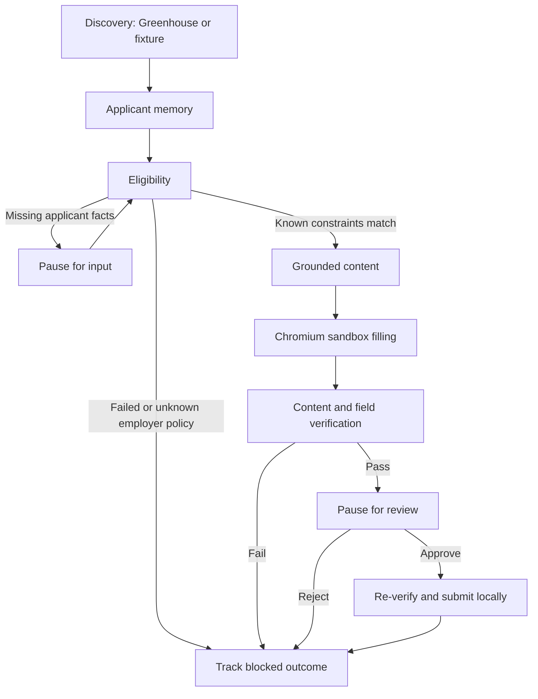

# Job Application Agents

A small, working research POC for stateful agents that discover jobs, check applicant constraints, prepare grounded content, fill a form in Chromium, verify it, and track a reviewed submission.

**Live discovery:** Greenhouse public Job Board API. **Application execution:** local ATS sandbox. **AI:** optional Groq Free-plan model or local Ollama; no-key mode uses deterministic facts and labels that choice.

## Run locally

Python 3.11+:

```bash
python3 -m venv .venv
source .venv/bin/activate
pip install -r requirements.lock
pip install --no-deps -e .
python -m playwright install chromium
uvicorn job_agents.api:app --host 127.0.0.1 --port 8000
```

Open http://127.0.0.1:8000. Select the first fictional job, start an application, inspect the checks and browser screenshot, then approve the sandbox submission to receive a receipt. Toggle the missing-info demo to test interruption, resumption, and reuse of the supplied fact. Rejected and ineligible applications do not submit.

Use **Find jobs** to query one Greenhouse company board (default `arvaintelligence`). Edit the applicant profile, select a live posting, and run the same preparation workflow. The original posting remains linked. A board token is the company segment of its Greenhouse board URL. Live extraction is conservative and incomplete: unknown employer sponsorship blocks applicants who need sponsorship, and an extracted-constraint match is not a definitive eligibility determination.

## Features implemented

- LangGraph nodes for discovery, memory, eligibility, content, browser application, verification, review, submission, and tracking.
- Degree, graduation window, experience, location, work authorization, sponsorship, and clearance checks on normalized fixtures.
- Missing-fact interrupts with Pydantic validation and applicant-scoped reuse.
- SQLite graph checkpoints and local restart/resume.
- Grounded content with fact IDs; model mode selects existing facts rather than inventing applicant claims.
- Real Chromium field filling, text resume upload, screenshots, and verification before a local submission.
- Session-isolated histories and receipts; duplicate submission protection.
- Simple editable profile and job feed interface, API, CLI, evaluation harness, and CI.

## Free AI modes

The default `CONTENT_MODE=deterministic` needs no credentials and makes no LLM call. For hosted model-based fact selection, configure `CONTENT_MODE=groq` and a `GROQ_API_KEY` secret from a Groq Free-plan account. `GROQ_MODEL` defaults to `openai/gpt-oss-20b`. For a local open model, set `CONTENT_MODE=ollama` and `OLLAMA_MODEL` to an installed model. Provider modes require separate verification with an available model/key; errors appear in the agent trace.

Never commit a key. No paid plan is needed. See [deployment instructions](docs/DEPLOYMENT.md).

## Architecture



Specialized agent roles are implemented as typed workflow nodes. The deterministic baseline is a reproducible orchestration demo, not autonomous LLM reasoning. Browser interaction uses known accessible labels in a controlled form; arbitrary production ATS navigation and screenshot-based grounding are future work.

## Checks and command-line demo

```bash
ruff check .
pytest -q -m 'not browser'
python scripts/evaluate.py
# With the local server already running:
RUN_BROWSER_TESTS=1 pytest tests/test_browser.py -q
job-agents demo --approve-sandbox
job-agents eligibility
```

The checked-in evaluation uses 16 explicitly labeled synthetic scenarios; it is not a representative dataset of real postings. Runtime screenshots, resumes, memory, and checkpoints stay in ignored `runtime/`.

## Three-day delivery

- **October 6:** repository, executable workflow, one live source, simple UI, tests, deployment configuration.
- **October 7 at 10 AM New York time:** better ingestion, memory retrieval, browser robustness, and evaluation cases.
- **October 8 at 10 AM New York time:** integrated evaluation, failure analysis, live verification, and demo documentation.

[Build plan](docs/BUILD_PLAN.md) · [Progress](docs/PROGRESS.md) · [Stack research and employer sources](docs/STACK_RESEARCH.md)

Commit dates reflect actual work. A chat automation continues work on the next two days; local scheduled execution requires the computer/app to be available.

## POC limits

No real employer submissions, CAPTCHA handling, Workday integration, authentication system, durable cloud database, or 200-posting labeled dataset is included. Render Free sleeps and resets local storage; see the deployment document. The supplied research brief guides the component roles, not operational actions or permission to submit job applications. Its named ownership, student identifiers, and old timeline are not imported into the project.
