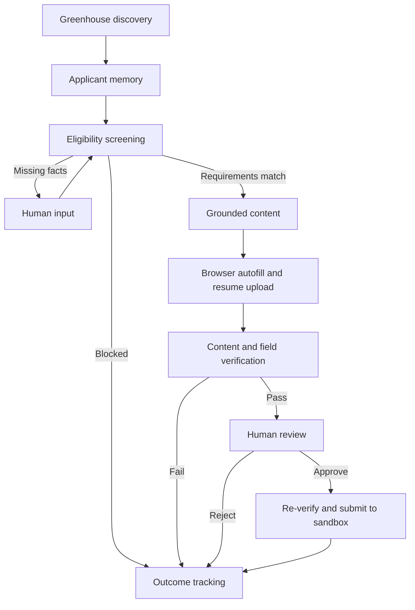

# ApplyPilot

**Discover opportunities. Prepare grounded applications. Stay in control.**

ApplyPilot is a stateful job-application platform that connects live job discovery with eligibility screening, fact-grounded application content, browser autofill, and human-in-the-loop review. Specialized workflow agents share applicant memory and checkpoints so each application can pause, resume, and leave a clear audit trail.

[Open ApplyPilot](https://job-application-agents.onrender.com) · [Deployment guide](docs/DEPLOYMENT.md) · [Technology research](docs/STACK_RESEARCH.md)

## What you can do

- **Find live jobs** — Search a company's Greenhouse board by keyword and open the original posting.
- **Manage your applicant profile** — Edit qualifications, skills, accomplishments, location, and work preferences.
- **Check eligibility** — Inspect degree, graduation, experience, location, work authorization, sponsorship, and clearance checks.
- **Resolve missing information** — Supply a missing fact, resume the workflow, and reuse that fact for the same applicant.
- **Prepare grounded content** — Select relevant verified profile facts using Groq, Ollama, or the credential-free deterministic mode.
- **Autofill an application** — Playwright fills a browser form, uploads a generated text resume, and captures screenshot evidence.
- **Review before submission** — Inspect the content and field checks, then approve or reject. Approved applications are verified again before submission.
- **Track outcomes** — View agent traces, application status, browser evidence, and submission receipts in a visitor-scoped history.

The hosted application connects to live Greenhouse listings and executes applications in ApplyPilot's built-in sandbox. It provides a complete discovery-to-receipt workflow without sending applications to employers.

## Try the platform

1. Open [ApplyPilot](https://job-application-agents.onrender.com) and review or edit the sample applicant.
2. Select a sample job to exercise the complete workflow, or use **Find jobs** to search a live Greenhouse board. The default board is `arvaintelligence`.
3. Choose **Prepare application**. Inspect the eligibility checks, grounded content, agent trace, and browser screenshot.
4. Supply any missing applicant facts, then approve or reject the prepared sandbox application.
5. Find the result and receipt under **Recent applications**.

A Greenhouse board token is the company segment in its job-board URL. Live requirement extraction is conservative: inspect the original posting for requirements that were not parsed. Unknown sponsorship policy blocks an applicant who needs sponsorship.

## Architecture



| Layer | Technology | Role |
| --- | --- | --- |
| Agent orchestration | LangGraph | Typed specialist nodes, conditional routing, interrupts, and checkpoints |
| Model integration | LangChain, Groq, Ollama | Structured selection of verified applicant facts |
| Frontend | React, Vite, Lucide | Responsive dashboard, profile editing, job cards, and review workspace |
| API and validation | FastAPI, Pydantic | Application endpoints and validated job/profile data |
| Browser execution | Playwright, Chromium | Form autofill, resume upload, screenshots, and field verification |
| Persistence | SQLite | Applicant facts, workflow state, application history, and receipts |
| Evaluation | pytest, scikit-learn, GitHub Actions | Workflow checks, eligibility metrics, and browser integration |

## Guardrails and visibility

Content references verified profile fact IDs; unsupported or repeated facts fail validation. A separate verification step checks both content and browser fields. Submission requires human approval and a fresh verification pass. Applicant memory and histories are scoped by visitor, and completed runs reject duplicate submission attempts.

Each agent records its action and outcome in the application trace. Browser screenshots and receipts make the execution reviewable. Errors appear in the workflow instead of being reported as successful applications.

## Run locally

Requires Python 3.11+ and Node.js 24.

```bash
git clone https://github.com/tanish-malekar/applypilot.git
cd applypilot
cd frontend
npm ci
npm run build
cd ..
python3 -m venv .venv
source .venv/bin/activate
pip install -r requirements.lock
pip install --no-deps -e .
python -m playwright install chromium
python scripts/start-server.py
```

Open http://127.0.0.1:8000. For frontend development, keep the API running and use `npm run dev` in `frontend/`; Vite proxies API requests to the local backend. Rebuild before running or deploying the production interface. Runtime screenshots, generated resumes, applicant facts, and checkpoints are stored in ignored `runtime/`.

## AI configuration

| Mode | Configuration | Behavior |
| --- | --- | --- |
| Credential-free | `CONTENT_MODE=deterministic` | Renders verified facts without an LLM call |
| Groq | `CONTENT_MODE=groq`, `GROQ_API_KEY` | Uses a hosted model to select and order relevant fact IDs |
| Ollama | `CONTENT_MODE=ollama`, `OLLAMA_MODEL` | Uses an installed local model for fact selection |

Groq defaults to `GROQ_MODEL=openai/gpt-oss-20b`. Configure credentials as environment secrets; never commit them. The hosted platform uses Groq, and its model-backed discovery-to-receipt workflow has been verified. Local Ollama requires a separately installed model.

## Validation

```bash
cd frontend && npm ci && npm run build && cd ..
ruff check .
pytest -q -m 'not browser'
python scripts/evaluate.py
# With the local server already running:
RUN_BROWSER_TESTS=1 pytest tests/test_browser.py -q
applypilot demo --approve-sandbox
applypilot eligibility
```

The current suite includes 16 unit/API/workflow tests and two real Chromium integration tests, covering both the backend browser flow and the React profile/input/review/history flow. The eligibility smoke set matches all 16 labeled synthetic scenarios; this small fixture set does not establish accuracy on real job postings. [Evaluation results](docs/day1-eligibility-results.json)

## Hosting and data

ApplyPilot runs on Render Free. Idle services may take about a minute to wake, and the free instance's local history and checkpoints reset on sleep, restart, or redeploy. Local installations retain SQLite state across process restarts. See the [deployment guide](docs/DEPLOYMENT.md) for configuration and storage behavior.

Use fictional applicant information on the public site. Application execution currently supports the built-in sandbox; arbitrary employer ATS submission and production account management are outside the supported workflow.
