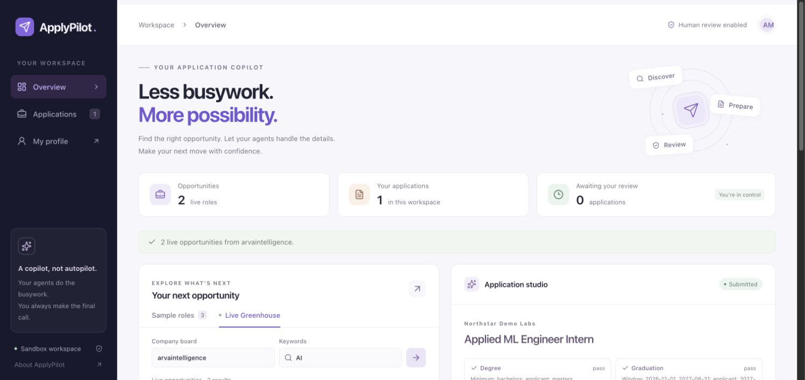
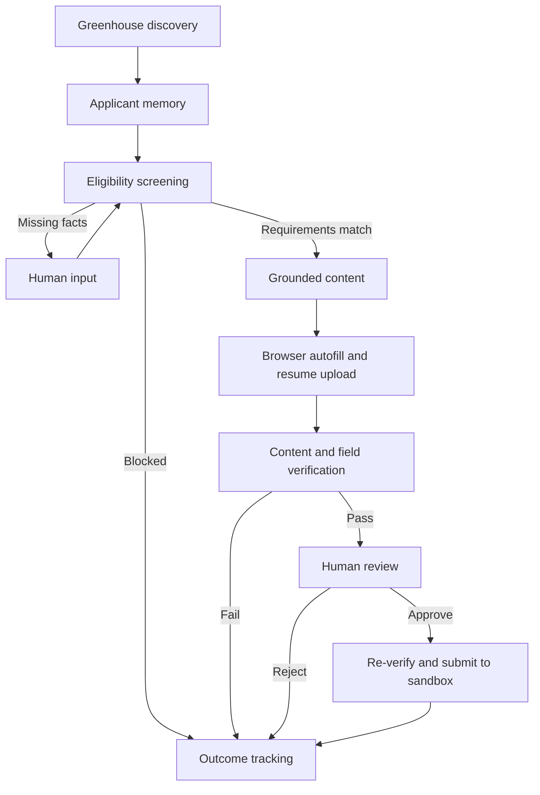

# ApplyPilot

**Discover opportunities. Prepare grounded applications. Stay in control.**

ApplyPilot is a stateful job-application platform that connects live job discovery with eligibility screening, fact-grounded application content, browser autofill, and human-in-the-loop review. Specialized workflow agents share applicant memory and checkpoints so each application can pause, resume, and leave a clear audit trail.

[Try the interactive demo — no login needed](https://job-application-agents.onrender.com/demo) · [Open ApplyPilot](https://job-application-agents.onrender.com) · [Account setup](docs/ACCOUNTS_SETUP.md) · [Deployment guide](docs/DEPLOYMENT.md) · [Technology research](docs/STACK_RESEARCH.md)



## What you can do

- **Explore the platform** — A public home page introduces the workflow and shows the actual dashboard.
- **Try it instantly** — A visual demo automatically replays the agent typing into fields, uploading a resume, checking the form, receiving sample human approval, and clicking Submit. Pause, replay, change speed, or inspect the documents and actual filled-form screenshot. It uses a fictional profile and recorded sandbox results, requires no login or details, and sends no applications.
- **Use your own account** — Email/password signup, login, recovery, and Google sign-in through Supabase; enable your providers using the account setup guide.

- **Find live jobs** — Search a company's Greenhouse board by keyword and open the original posting.
- **Manage your applicant profile** — Edit qualifications, skills, accomplishments, location, and work preferences.
- **Check eligibility** — Inspect degree, graduation, experience, location, work authorization, sponsorship, and clearance checks.
- **Resolve missing information** — Supply a missing fact, resume the workflow, and reuse that fact for the same applicant.
- **Prepare grounded content** — Generate separate downloadable text resumes, cover letters, and explicit application-question answers from verified facts. Groq or Ollama selects facts; fixed prose preserves grounding. Unsupported answers pause for your input.
- **Autofill an application** — Playwright fills a browser form, uploads a generated text resume, and captures screenshot evidence.
- **Review before submission** — Inspect the content and field checks, then approve or reject. Approved applications are verified again before submission.
- **Track outcomes** — View agent traces, application status, browser evidence, and submission receipts in your account-scoped history (visitor-scoped in the sample workspace).

The hosted application connects to live Greenhouse listings and executes applications in ApplyPilot's built-in sandbox. It provides a complete discovery-to-receipt workflow without sending applications to employers.

## Try the platform

For a quick walkthrough, select **Try the demo** on the home page or open [/demo](https://job-application-agents.onrender.com/demo) directly. It works without account services and uses recorded outputs from a real deterministic Playwright sandbox run, including its form screenshot and receipt. It does not generate a new application or mutate account history. For a live workflow using your own profile:

1. Open [ApplyPilot](https://job-application-agents.onrender.com) and sign in to your workspace. Account-enabled installations support signup or configured Google sign-in. Review or edit your applicant profile. Local installations without managed accounts also provide the live sample workspace at `/practice`.
2. Open **Browse jobs** to search a live Greenhouse board, or use a sample role to explore the complete workflow. The default board is `arvaintelligence`.
3. Choose **Prepare** on a job card. Inspect the eligibility checks, grounded content, agent trace, and browser screenshot.
4. Supply any missing applicant facts, then approve or reject the prepared sandbox application.
5. Find the result and receipt in the **All applications** table. Filter by status or open an application to inspect its evidence.

A Greenhouse board token is the company segment in its job-board URL. Live requirement extraction is conservative: inspect the original posting for requirements that were not parsed. Unknown sponsorship policy blocks an applicant who needs sponsorship.

## Architecture



| Layer | Technology | Role |
| --- | --- | --- |
| Agent orchestration | LangGraph | Typed specialist nodes, conditional routing, interrupts, and checkpoints |
| Model integration | LangChain, Groq, Ollama | Structured selection of verified applicant facts |
| Frontend | React, Vite, Lucide | Responsive dashboard, profile editing, job cards, and review workspace |
| API and validation | FastAPI, Pydantic | Application endpoints and validated job/profile data |
| Browser execution | Playwright, Chromium | Form autofill, resume upload, screenshots, and field verification |
| Accounts | Supabase Auth | Managed email/password and Google OAuth sessions, verified by the API |
| Persistence | PostgreSQL, SQLite | Private account profiles, memory, LangGraph checkpoints, history, receipts, and screenshot evidence |
| Evaluation | pytest, scikit-learn, GitHub Actions | Labeled synthetic cases, grounding checks, and real browser/PostgreSQL integration |
| Observability | LangSmith (optional) | Metadata-only node timings/outcomes with a durable hard usage cap |

## Guardrails and visibility

Content references verified profile fact IDs; unsupported or repeated facts fail validation. A separate verification step checks both content and browser fields. Submission requires human approval and a fresh verification pass. Account-enabled requests are verified with Supabase before the API uses the account ID for ownership. Applicant memory, profiles, runs, and screenshots are account-scoped; completed runs reject duplicate submission attempts. The sample workspace uses a visitor cookie when account configuration is absent.

Each agent records its action and outcome in the application trace. Optional [LangSmith tracing](docs/OBSERVABILITY.md) exports only safe metadata and timings; live activation requires maintainer setup. Browser screenshots and receipts make the execution reviewable. Errors appear in the workflow instead of being reported as successful applications.

## Run locally

Requires Python 3.11+ and Node.js 24.

```bash
git clone https://github.com/tanish-malekar/applypilot.git
cd applypilot
cd frontend
npm ci
npm run build
cd ..
python3 -m venv .venv
source .venv/bin/activate
pip install -r requirements.lock
pip install --no-deps -e .
python -m playwright install chromium
python scripts/start-server.py
```

Open http://127.0.0.1:8000. For frontend development, keep the API running and use `npm run dev` in `frontend/`; Vite proxies API requests to the local backend. Rebuild before running or deploying the production interface. Runtime screenshots, generated resumes, applicant facts, and checkpoints are stored in ignored `runtime/`.

## AI configuration

| Mode | Configuration | Behavior |
| --- | --- | --- |
| Credential-free | `CONTENT_MODE=deterministic` | Renders verified facts without an LLM call |
| Groq | `CONTENT_MODE=groq`, `GROQ_API_KEY` | Uses a hosted model to select and order relevant fact IDs |
| Ollama | `CONTENT_MODE=ollama`, `OLLAMA_MODEL` | Uses an installed local model for fact selection |

Groq defaults to `GROQ_MODEL=openai/gpt-oss-20b`. Configure credentials as environment secrets; never commit them. The hosted platform uses Groq, and its model-backed discovery-to-receipt workflow has been verified. Local Ollama requires a separately installed model.

## Validation

```bash
cd frontend && npm ci && npm run build && cd ..
ruff check .
pytest -q -m 'not browser'
python scripts/evaluate.py
# With the local server already running:
RUN_BROWSER_TESTS=1 pytest -q -m browser
python scripts/evaluate_integrated.py
applypilot demo --approve-sandbox
applypilot eligibility
```

The suite covers workflow and API behavior, account isolation and token rejection, five Chromium browser tests, and a PostgreSQL restart/resume test. Browser auth tests use an isolated provider fixture; real Google and email delivery require live provider verification. Set `PG_TEST_DATABASE_URL` to an isolated PostgreSQL database to run the persistence test. GitHub Actions provisions this database automatically. The eligibility smoke set matches all 16 labeled synthetic scenarios; this small fixture set does not establish accuracy on real job postings. [Eligibility results](docs/day1-eligibility-results.json) · [Integrated evaluation and limitations](docs/EVALUATION.md)

## Hosting and data

ApplyPilot runs on Render Free. Idle services may take about a minute to wake. Account-enabled deployments use an external Supabase PostgreSQL database so profiles, histories, checkpoint memory, and screenshot evidence survive a restart or redeployment. Without `DATABASE_URL`, the sample workspace uses local SQLite and its hosted state resets with the free instance. Local installations retain SQLite state across process restarts.

Managed account activation requires the project's public Supabase configuration, a private PostgreSQL session-pooler URI, and provider setup. See [account setup](docs/ACCOUNTS_SETUP.md) for Google OAuth, confirmation/reset email delivery, and creating a confirmed test account. Private credentials are entered in hosting/provider settings. The deployed application never needs a Supabase admin key.

Application execution supports the built-in sandbox; arbitrary employer ATS submission is outside the supported workflow. The public sample workspace uses fictional applicant information. Account owners can save their own verified profile details; the [data information page](https://job-application-agents.onrender.com/privacy) explains storage and model processing.
